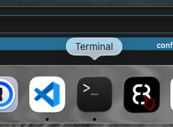
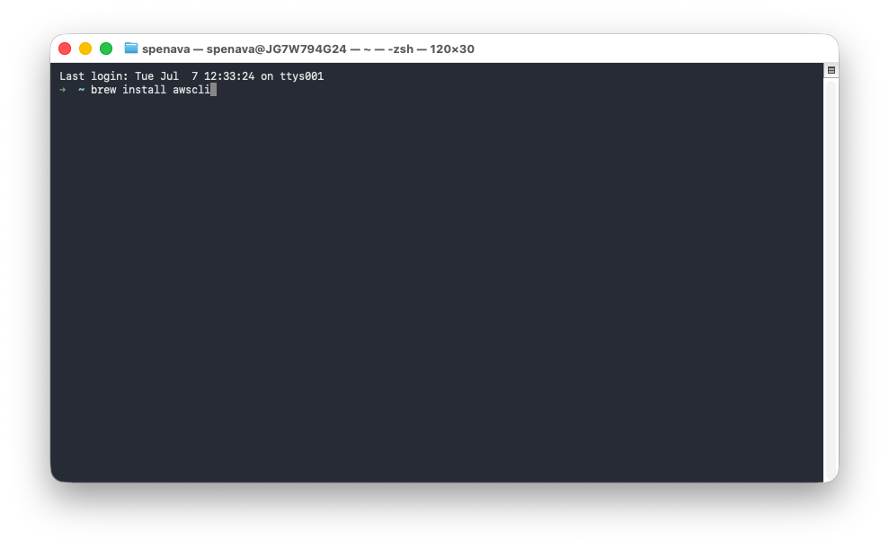
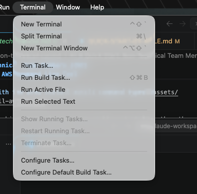
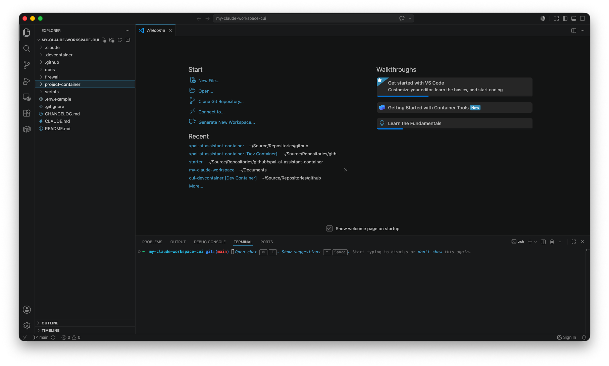
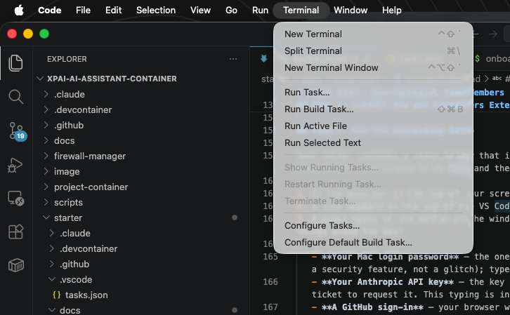
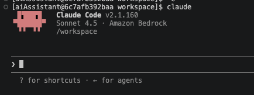
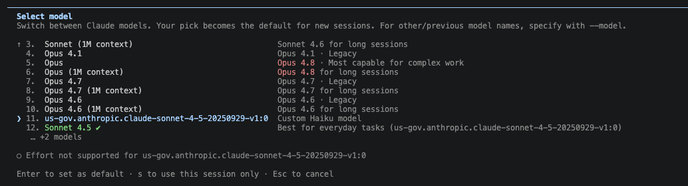

# CUI Project Setup Guide

This guide is for projects that work with **CUI (Controlled Unclassified Information)** — sensitive or controlled data. It's a **one-time setup**: once you've finished it, you won't need this page again day to day.

- 🔁 **Already set up, just need to get back in?** → [Getting Back Into Your Container](quick-start/getting-back-in.md) is your everyday reference.
- 🆘 **Something broken?** → [Troubleshooting](TROUBLESHOOTING.md#cui--aws-bedrock) has the CUI/Bedrock-specific fixes.

This guide works for anyone, technical or not — command blocks are ready to copy-paste, and each `💡 Tip` you can expand explains what a command actually did, for anyone who wants to know.

## Is this you?

**Does your project handle CUI?** If you're not sure, ask your project lead before continuing — the rest of this guide assumes yes.

**Before this guide**, you need a working copy of the starter template on your computer. That part isn't CUI-specific, so follow whichever fits you, then come back here:

- **Non-technical?** Follow the [non-technical picture guide](quick-start/non-technical.md) — Steps 1–5 (install VS Code, create your repo, clone it, install the Dev Containers extension, admin privileges). **When you create your repo (Step 2), name it with a `-cui` suffix** (e.g. `my-claude-workspace-cui`) so it's clearly flagged as CUI.
- **Technical?** Create your repo from the [starter template](https://github.com/new?owner=rise8-us&template_name=xpai-ai-assistant-container-starter&template_owner=rise8-us), naming it with a `-cui` suffix (e.g. `my-project-cui`), then follow the [main README](../README.md) Steps 2–3 to clone it and run the onboarding script (`./scripts/onboard.sh`) — you still need this for Homebrew/tool installation and GitHub auth. Skip README Step 1 (Anthropic API key) entirely, and when Step 3's onboarding script prompts for an API key, **press Enter to leave it blank** — CUI projects authenticate through AWS Bedrock instead (Step 5 below handles CUI-specific registry auth separately via `onboard-cui.sh`).

> 🚨 **Do NOT host CUI code on GitHub.** Before pushing any CUI-related work, swap your remote from GitHub to your approved GitLab instance (see the next section). GitHub is only where you cloned the starter template from — it is not authorized for CUI repositories going forward.

### Remove GitHub and point `origin` at GitLab

Run these commands from the repository root on your laptop. Replace the GitLab URL with the one for your project.

```bash
# 1. Confirm what origin currently points at
git remote -v

# 2. Remove GitHub as origin
git remote remove origin

# 3. Create a new, private repository on your approved GitLab instance,
#    then copy its clone URL (HTTPS or SSH) and add it as origin
git remote add origin git@gitlab.example.com:your-group/your-repo.git

# 4. Verify origin now points at GitLab
git remote -v

# 5. Push all branches and tags to GitLab
git push -u origin --all
git push origin --tags
```

After the push completes, **archive or delete the GitHub repository** to prevent accidental future pushes.

If you have existing GitHub history, branches, issues, or PRs to bring over, follow GitLab's official [Import your project from GitHub](https://docs.gitlab.com/user/project/import/github/) guide before running the steps above.

## What to expect on CUI

- **Local development only** - Cannot use GitHub Codespaces
- **AWS Bedrock required** - FedRAMP High and DoD IL4/5 approved models
- **Firewall protection required** - CMMC Level 2 compliant network isolation mandatory for CUI data
- **Time-limited credentials** - 8-hour session expiration for security
- **Code hosting** - GitLab only; GitHub is not authorized for CUI repositories

| Tool/Credential | Works in CUI? | Why |
|-----------------|---------------|-----|
| **Anthropic API Key** (`sk-ant-api03-...`) | ❌ No | Firewall blocks Anthropic API endpoints |
| **Gemini CLI** | ❌ No | Firewall blocks Google AI endpoints |
| **AWS Bedrock credentials** | ✅ Yes | GovCloud endpoints are whitelisted |
| **Claude Code with Bedrock** | ✅ Yes | Uses whitelisted Bedrock endpoints |

> **Got an Anthropic API key from #helpdesk?** That key is for **non-CUI projects only**. For CUI projects, you need AWS Bedrock access via a project-scoped permission set (see Step 2 below).

💡 What data protections do I get on GovCloud Bedrock?

- Your prompts and responses are handled entirely by **AWS GovCloud** (FedRAMP High, ITAR, CMMC-compliant) — they never reach Anthropic's servers, so Anthropic's Zero Data Retention (ZDR) contract term doesn't apply here (and doesn't need to — AWS GovCloud's own policies cover it).
- Nonessential telemetry (Statsig, Sentry, the `/bug` command) is **off by default** on GovCloud Bedrock — no configuration needed.

See [Security Model: Data Retention by Provider](security-model.md#data-retention-by-provider) for the full comparison across providers.

💡 Is prompt caching allowed on CUI?

Yes. Prompt caching runs inside GovCloud Bedrock, which is **FedRAMP High authorized** — above the FedRAMP Moderate baseline that CMMC Level 2 requires of a cloud provider handling CUI. The cache is scoped to your AWS account, stays in-region, and expires after 5 minutes by default.

Protection of CUI at rest (SC.L2-3.13.16) and FIPS-validated cryptography (SC.L2-3.13.11) are **inherited from AWS** — record them as inherited via the AWS Customer Responsibility Matrix in your SSP.

Evidence: [AWS CMMC L2 — ESPs and CSPs](https://docs.aws.amazon.com/prescriptive-guidance/latest/cmmc-level-2-compliance-on-aws/external-service-providers-and-csps.html) · [AWS FedRAMP Services in Scope](https://aws.amazon.com/compliance/services-in-scope/FedRAMP/) · [Bedrock in GovCloud (US)](https://docs.aws.amazon.com/govcloud-us/latest/UserGuide/govcloud-bedrock.html) · [Bedrock prompt caching](https://docs.aws.amazon.com/bedrock/latest/userguide/prompt-caching.html)

Disable with `DISABLE_PROMPT_CACHING=1` in `.env` if your program office requires it.


See https://docs.google.com/document/d/1gtr62hDuvpnfzrc9Sqny4iYzHx_dBaGhpPcp4gRDUxk/edit?tab=t.0.

## Setup steps

**Before you start:** you'll need to be assigned to a `BedrockAccess-{YourProject}` permission set (e.g. `BedrockAccess-KM`, `BedrockAccess-TAK`) — ask your **Delivery Lead** if you're not sure whether you have it or what your project's suffix is.

> **Can't run `aws sso login` on your machine?** (e.g. a non-Rise8-managed laptop) — see [BEDROCK-CREDENTIALS-NO-SSO.md](BEDROCK-CREDENTIALS-NO-SSO.md) for the static-key + AssumeRole alternative instead of Steps 2–3 below. The rest of this guide assumes SSO works for you.

### Step 1: Install the AWS CLI

Claude runs in the **government cloud (AWS GovCloud)** for CUI projects instead of the public Claude service, and your machine needs a small tool to connect to it.

Open the **Terminal** app (Dock icon, or **Cmd+Space** → `terminal`):



Then run:

```bash
brew install awscli
```



<details>
<summary>💡 What did that do?</summary>

<br>

**AWS** (Amazon Web Services) runs the secure government cloud where Claude lives for CUI projects — data stays in an environment approved for controlled information. `awscli` is the small program your machine uses to sign in to that cloud; `brew` is the Mac package manager that fetched and installed it.

</details>

### Step 2: Set up your Bedrock profile

Run the setup script with your project's permission set suffix from above:

```bash
./scripts/setup-bedrock-profile.sh YourProjectSuffix
```

The script prints the profile and role name it's about to set up and asks you to confirm — press **Enter** (or type `y`) to proceed. Your browser then opens asking you to sign in and approve — approve it. **Write down the profile name it prints** (it looks like `bedrockaccess-yourprojectsuffix`) — you'll use it every day going forward, spelled exactly the same.

<details>
<summary>💡 What did that do?</summary>

<br>

This writes profile `bedrockaccess-yourprojectsuffix` (role `BedrockAccess-YourProjectSuffix`) into `~/.aws/config` non-interactively — no wizard prompts to answer, no risk of leaving a required field blank. It also signs you in once immediately and verifies your credentials work, as a bonus check, before finishing (you'll still repeat the sign-in every ~8 hours as part of daily use).

**SSO** (single sign-on) means you sign in once with your Rise8 identity, and AWS trusts that sign-in — no separate AWS password to manage. If you work on multiple projects, run this script once per project — they share the same underlying `[sso-session rise8]` block automatically.

</details>

### Step 3: Switch your folder to CUI mode

Your folder from the template comes ready for both standard and CUI projects. This flips it to CUI mode — with the mandatory firewall protection — with one command.

In VS Code, menu bar → **Terminal → New Terminal**:



A terminal panel opens at the bottom, already sitting in your folder:



Type (or copy-paste) and press **Enter**:

```bash
mv .devcontainer/devcontainer.cui.json .devcontainer/devcontainer.json
```

No news is good news — the command prints nothing when it works.

**Firewall features (required for CUI):**
- Deny-by-default iptables firewall
- Whitelist-based network access control
- Prevents data exfiltration via prompt injection attacks
- CMMC Level 2 compliant boundary protection

📖 **[Complete Firewall Documentation](firewall/README-FIREWALL.md)** - Setup, configuration, and troubleshooting

<details>
<summary>💡 What did that do?</summary>

<br>

Your folder contains a **recipe file** that tells VS Code how to build Claude's workspace. The template ships with two recipes: the standard one and a CUI one (with the extra security controls, like the network firewall, that CUI projects require). The `mv` command ("move") renames the CUI recipe to the name VS Code looks for — so from now on, when VS Code builds the workspace, it builds the CUI version.

**Note:** If you need to run multiple CUI projects concurrently, edit `.devcontainer/docker-compose.firewall.yml` and change the `container_name` fields to unique names (e.g., `myproject-firewall-manager`, `myproject-ai-assistant`).

</details>

### Step 4: Set up the CUI settings file

```bash
cp .env.example.cui .env
```

Like the last command, it prints nothing when it works.

<details>
<summary>💡 What did that do?</summary>

<br>

The `.env` file holds your workspace's personal settings — things like which cloud Claude connects through. It's private to your computer and never uploaded to GitHub. The template ships a ready-made CUI version of those settings (`.env.example.cui`); this copies it into place as your active `.env`.

</details>

### Step 5: Run the CUI onboarding

**In VS Code:** menu bar → **Terminal → Run Task...**:



Click **Run CUI Onboarding**. If your browser opens asking you to authorize GitHub, approve it. Done when you see the **"CUI Registry Setup Complete!"** banner with green checkmarks.

**Or from a terminal:**

```bash
./scripts/onboard-cui.sh
```

> Safe to re-run any time — if a later step ever fails with an **"unauthorized"** error, re-running this is the fix.

<details>
<summary>💡 What did that do?</summary>

<br>

The building blocks of Claude's CUI workspace (the container and its firewall) live in a **private company storehouse** on GitHub. Private means your computer needs to prove who you are before it can download from it. This signs you in to GitHub and hands a fresh access key to the container software so it can fetch those building blocks. Keys go stale over time — which is why re-running this fixes "unauthorized" errors.

</details>

## First launch

With setup done, start the container (in VS Code: open the folder, wait for the **Dev Container** badge) and open a terminal.

1. Type `claude` and press **Enter**. Check the welcome text — it should say **"Amazon Bedrock"**. That confirms you're running through the government cloud, not the public service.

   

   > If it doesn't say Bedrock, or Claude complains about credentials, your Step 2 sign-in has likely expired — see [Getting Back Into Your Container](quick-start/getting-back-in.md) to refresh it.

2. Pick the government-approved model. Type `/model` and press **Enter**. Select the entry whose name starts with **`us-gov.anthropic.`** (shown as **Sonnet 5 — Best for everyday tasks**), then press **Enter** to make it your default.

   

   > ⚠️ Pick only models whose names start with **`us-gov.anthropic.`** — the other models in the list are **not available** on the government cloud, and choosing one will cause errors.

3. **Want the most capable model?** Opus was recently added to the government cloud:

   ```
   /model us-gov.anthropic.claude-opus-4-8
   ```

   Opus is stronger for complex work; Sonnet is faster for everyday tasks. Switch back and forth with `/model` any time — this is a one-time preference, not something you redo daily.

Unlike the standard (non-CUI) setup, there's no sign-in or API key prompt inside Claude itself — your AWS sign-in from Step 2 is what authenticates you, refreshed daily per [Getting Back Into Your Container](quick-start/getting-back-in.md).

For how to work with Claude day to day — what the folder is, what Claude can see and do — see [Step 9 of the standard guide](quick-start/non-technical.md#step-9-work-with-claude); it all applies here too.

## Where to go next

- **Every day after this:** [Getting Back Into Your Container](quick-start/getting-back-in.md) — the daily sign-in/refresh routine and how to resume a conversation.
- **Something not working?** [Troubleshooting: CUI / AWS Bedrock](TROUBLESHOOTING.md#cui--aws-bedrock).

## Features

🔒 **Security Compliance** - Meets CMMC Level 2 and government security standards
🛡️ **Network Firewall** - Deny-by-default iptables firewall prevents data exfiltration
🔄 **Automatic refresh** - 8-hour credential rotation for security
🏠 **Local only** - No cloud development environments
🔐 **Minimal permissions** - Only Bedrock model access, zero container capabilities
⚡ **Prompt Caching** - Enabled by default, inside the FedRAMP-authorized GovCloud Bedrock boundary ([why this is CMMC Level 2 acceptable, with evidence](#what-to-expect-on-cui)); disable by adding `DISABLE_PROMPT_CACHING=1` to `.env` if needed
