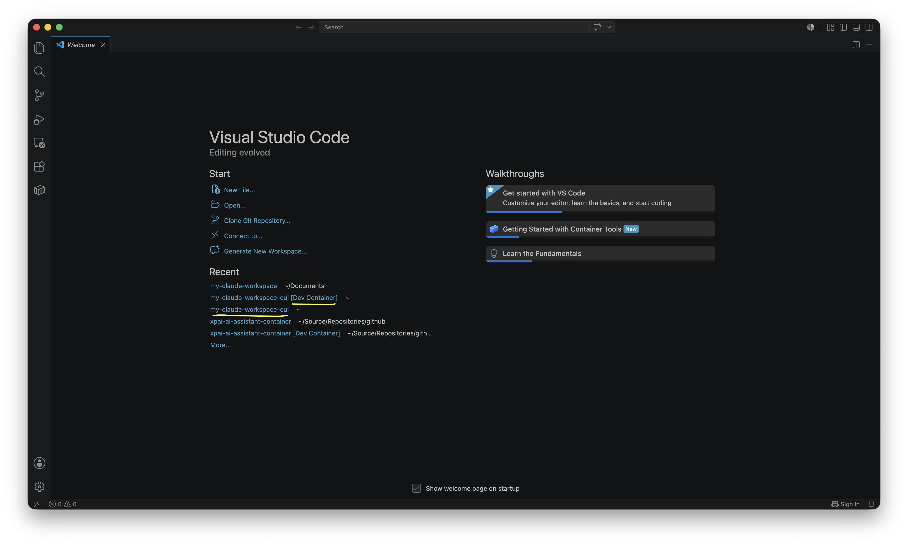

# Getting Back Into Your Container

**[← Back to Quick Start by Role](../QUICK-START-BY-ROLE.md)** | **[Main README](../../README.md)**

You finished the setup guide, closed your laptop, and now it's tomorrow. This page is your everyday "how do I get back to Claude?" reference — bookmark it.

## The Recent List: Two Entries, One Folder

Open **Visual Studio Code**. On the Welcome tab, look at the **Recent** list — your folder shows up **twice**:



- **`my-claude-workspace-cui [Dev Container]`** — the tagged entry. Clicking it jumps straight back **inside the container** (Claude's workspace).
- **`my-claude-workspace-cui`** — the plain entry. Clicking it opens the folder **outside the container**, on your Mac.

Which one to click depends on which kind of project you're on — that's the rest of this page.

---

## Standard (non-CUI) Projects: Click the `[Dev Container]` Entry

Your route back is short:

1. Open **VS Code**.
2. In the **Recent** list, click your folder's **`[Dev Container]`** entry. VS Code starts the container and drops you right back inside — much faster than the first-time build. (Clicked the plain entry by mistake? No problem — a pop-up will offer to **Reopen in Container**; click it.)
3. Wait for the **blue "Dev Container" badge** in the bottom-left corner.
4. Click **Terminal → New Terminal**. Starting something new, or picking up where you left off?
   - New conversation: type `claude` and press **Enter**.
   - Continuing something: type `claude --continue` (or `-c`) to resume your most recent conversation in this folder, or `claude --resume` (or `-r`) to pick from a list if you have more than one going.

That's the whole routine: **VS Code → `[Dev Container]` entry → terminal → `claude` (or `--continue`/`--resume`).**

> 💡 **Tip:** Name conversations you'll want to find later, so they're easy to pick out of the `--resume` list — start with `claude -n my-task-name`, or type `/rename my-task-name` inside a conversation that's already running.

---

## CUI Projects: Your Daily Workflow

On CUI projects, your government cloud sign-in is a **temporary badge that expires every 8 hours**. The best habit is refreshing it **before** you start work each day — proactively, not after Claude breaks on you mid-task. That's the routine below; a mid-day expiry is covered as the edge case it should be, near the bottom.

### ⚠️ Why the `[Dev Container]` entry fails after 8+ hours

The `[Dev Container]` entry takes you straight back into the container **exactly as you left it — with yesterday's badge still inside**. If it's been 8+ hours since your last sign-in, that badge is expired: the container may fail to start, and even if it opens, Claude can't connect to the government cloud and errors out. Clicking it first doesn't save time — you'd have to back out, sign in, and rebuild anyway. That's why the morning routine below starts from the **plain** (non-`[Dev Container]`) entry.

### Morning: refresh before you start

**Recommended — one command, from a terminal outside the container (on your Mac, in the *plain* entry):**

```bash
AWS_PROFILE=bedrockaccess-yourproject ./scripts/refresh-credentials.sh --vscode
```

Replace `bedrockaccess-yourproject` with the exact profile name printed when you ran `setup-bedrock-profile.sh` during setup — it has to match character for character. This signs you into AWS SSO (your browser opens — approve it), exports fresh credentials, rebuilds the container, and reopens VS Code for you.

<details>
<summary>💡 Prefer to do it by hand, or don't have the DevContainer CLI installed?</summary>

<br>

1. Open the **Terminal** app and go to your CUI folder:

   ```bash
   cd ~/Documents/my-claude-workspace-cui
   ```

2. Sign in to the government cloud — your browser opens to confirm; approve it:

   ```bash
   aws sso login --profile bedrockaccess-yourproject
   ```

3. Hand your fresh sign-in to Claude's workspace:

   ```bash
   aws configure export-credentials --profile bedrockaccess-yourproject --format env-no-export > .env.bedrock
   ```

   This one prints nothing when it works.

4. Back in **VS Code**, from the **plain** (non-`[Dev Container]`) entry, press **Cmd+Shift+P**, type `rebuild`, and choose **Dev Containers: Rebuild and Reopen in Container**. This restarts the workspace so it picks up the fresh badge. (Rebuilding is safe — your files aren't touched.)

   > If the rebuild fails with an **"unauthorized"** error, your download key went stale — re-run **Terminal → Run Task... → Run CUI Onboarding**, then rebuild again.

</details>

### Start Claude — new conversation or resume?

Once the blue **Dev Container** badge appears, click **Terminal → New Terminal**. Rebuilding doesn't erase your conversation — Claude Code's session history lives in a volume that survives rebuilds — so resume instead of starting fresh whenever you're continuing something:

- `claude --continue` (or `claude -c`) picks up your most recent conversation in this folder automatically.
- `claude --resume` (or `claude -r`) opens a picker if you have more than one conversation going and want to choose.
- `claude` on its own starts a brand-new conversation.

Check that the welcome/status text says **"Amazon Bedrock"** — that's your confirmation you're on the government cloud, not the public service.

> 💡 **Tip:** Name conversations you'll want to find later, so they're easy to pick out of the `--resume` list — start with `claude -n my-task-name`, or type `/rename my-task-name` inside a conversation that's already running.

### End of day

Either let Claude finish what it's doing, or — if you want to pick it back up tomorrow — `/rename my-task-name` before you close up. Tomorrow's morning refresh rebuilds the container, but your named conversation is waiting for you with `claude --resume`.

### Coming back within the same 8 hours?

If you signed in this morning and just closed VS Code for lunch, your badge is still good — the **`[Dev Container]`** entry works fine. The sign-in-first routine is only needed when the badge has expired: at the start of each day, or when Claude suddenly stops responding partway through a long one.

<details>
<summary>💡 Tip: How do I know which situation I'm in?</summary>

<br>

- **Less than 8 hours since your last `aws sso login`** → badge is still valid → click the **`[Dev Container]`** entry and go.
- **8+ hours (or you're not sure)** → assume it's expired → run the morning refresh above.
- **Claude was working and suddenly isn't?** That's the badge expiring mid-day — a rare edge case if you're refreshing each morning, but the fix is the same: run the morning refresh above, then `claude --continue`.

</details>

---

**[← Back to Quick Start by Role](../QUICK-START-BY-ROLE.md)** | **[Main README](../../README.md)**
