# Quick Start: Non-Technical Team Members

**[← Back to Quick Start by Role](../QUICK-START-BY-ROLE.md)** | **[Main README](../../README.md)**

## Step 1: Install Visual Studio Code

Visual Studio Code (or "VS Code") is the app you'll use to talk to Claude. It's free, and it's already approved in the Rise8 App Depot — no admin request needed.

1. Click the **Jamf icon** in your menu bar (top-right of your screen, near the clock) and choose **Get Software**.

   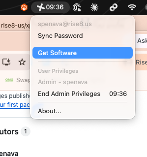

2. The **Rise8 App Depot** opens. Type `code` in the search box on the left.
3. Find **Microsoft Visual Studio Code** in the results and click **Install**.

   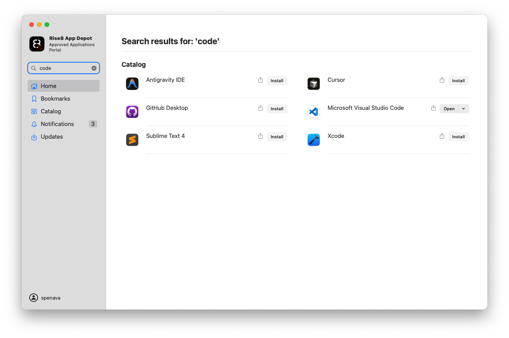

4. Wait for the install to finish — the button changes to **Open** when it's done. You can open it now or wait; we'll use it in a later step.

💡 Tip: What did I just do?

 

- **VS Code** is a text editor — like Word, but for working with files and code. It's also where Claude lives: you'll chat with Claude in a panel right inside it.
- The **Rise8 App Depot** is our company's approved app store. Installing from there means the app is already vetted and you don't need special permissions.

So in this step, you installed the one app you'll do all your Claude work in.

---

## Step 2: Create a Folder for Your Claude Work

First, you'll create your own personal space on GitHub to hold everything Claude needs. We've made a template that sets it all up for you.

**[Click here to create your folder](https://github.com/new?owner=rise8-us&template_name=xpai-ai-assistant-container-starter&template_owner=rise8-us)**

That link opens a GitHub page with the template already selected. Fill it out like this:

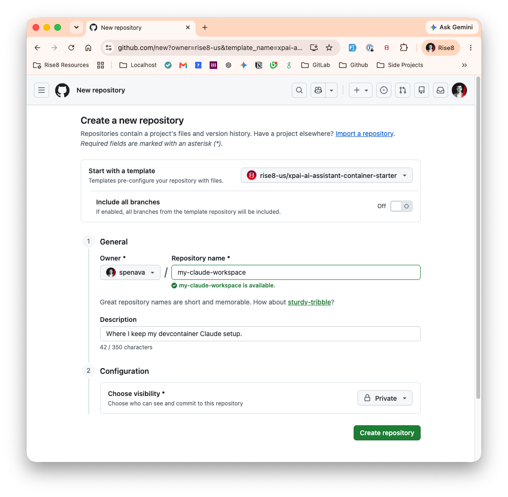

1. **Start with a template** — this should already show `rise8-us/xpai-ai-assistant-container-starter`. Leave it as-is. (Leave **Include all branches** switched off.)
2. **Owner** — pick your own GitHub username from the dropdown.
3. **Repository name** — give your folder a name, like `my-claude-workspace`. A green checkmark means the name is available.
4. **Description** *(optional)* — a short note about what this is, like "Where I keep my Claude setup."
5. **Choose visibility** — select **Private** so only you can see it.
6. Click the green **Create repository** button.

That's it — GitHub will create your folder and take you to it. You can close the page when you're done looking around; in the next step, VS Code will find your folder for you.

💡 Tip: What did I just do?

 

Think of it like this:

- **GitHub** is like a shared filing cabinet on the internet where files are stored and organized.
- A **repository** (or "repo") is one drawer in that cabinet — your own folder for a project.
- A **template** is a pre-packed folder. Instead of starting empty, your new folder comes with everything Claude needs already inside, set up by our team.

So in this step, you made your own private copy of a ready-to-go folder. You didn't change anything for anyone else — this copy is all yours, and it's private so only you can see it.

---

## Step 3: Download Your Folder to Your Computer

Your folder lives on GitHub right now. In this step, you'll use VS Code to download a copy to your computer so Claude can work in it. Along the way, VS Code will ask to connect to your GitHub account — that's expected, and you'll approve it a few times.

1. Open **Visual Studio Code**. On the Welcome tab, click **Clone Git Repository...** under "Start".

   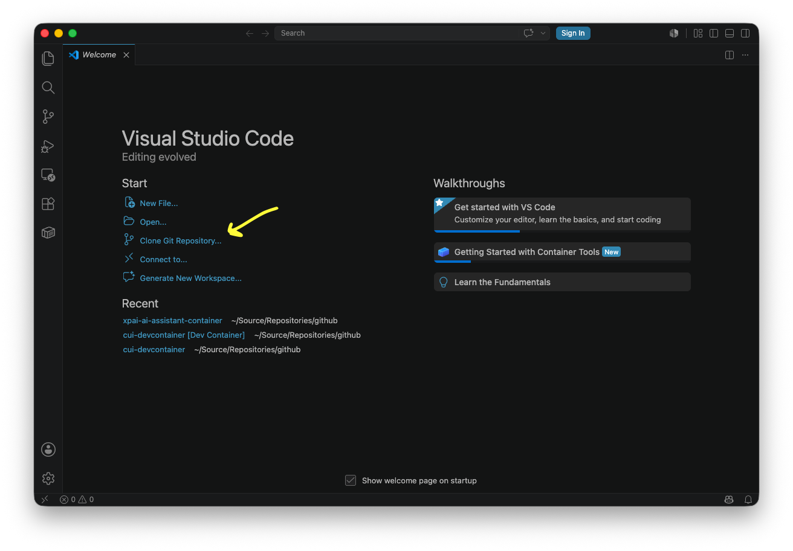

2. A small box appears at the top of the window. Click **Clone from GitHub**.

   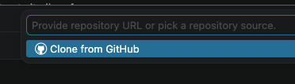

3. Now VS Code needs your permission to connect to your GitHub account. You'll see a few pop-ups in a row — approve each one:

   - VS Code asks to sign in using GitHub. Click **Allow**.

     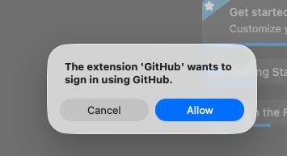

   - Your web browser opens to a GitHub page. Make sure it shows your account, then click **Continue**.

     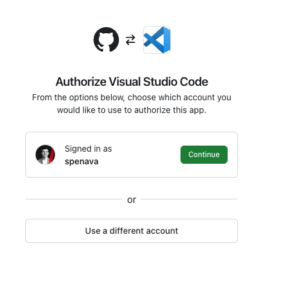

   - GitHub lists what VS Code is asking for. Click the green **Authorize Visual-Studio-Code** button.

     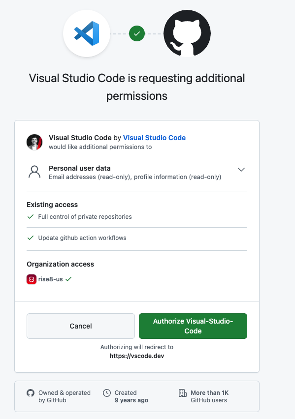

   - Your browser asks to send you back to the app. Click **Open Visual Studio Code**.

     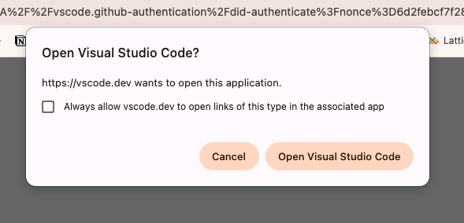

4. Back in VS Code, the box at the top now lists your GitHub folders. Click the one you created in Step 2 (for example, `my-claude-workspace`). You can type its name to find it faster.

   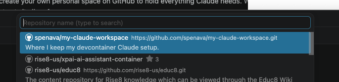

5. VS Code asks where to save the copy on your computer. Pick a spot you'll remember — **Documents** works well — then click **Select as Repository Destination**.

   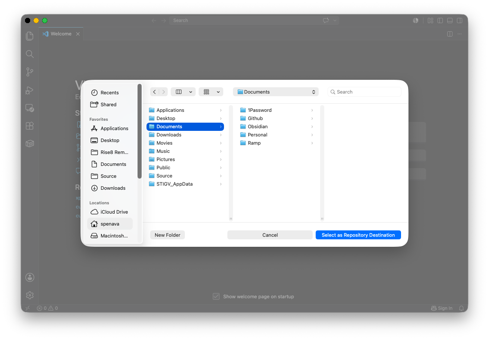

6. When the download finishes, VS Code asks if you'd like to open it. Click **Open**.

   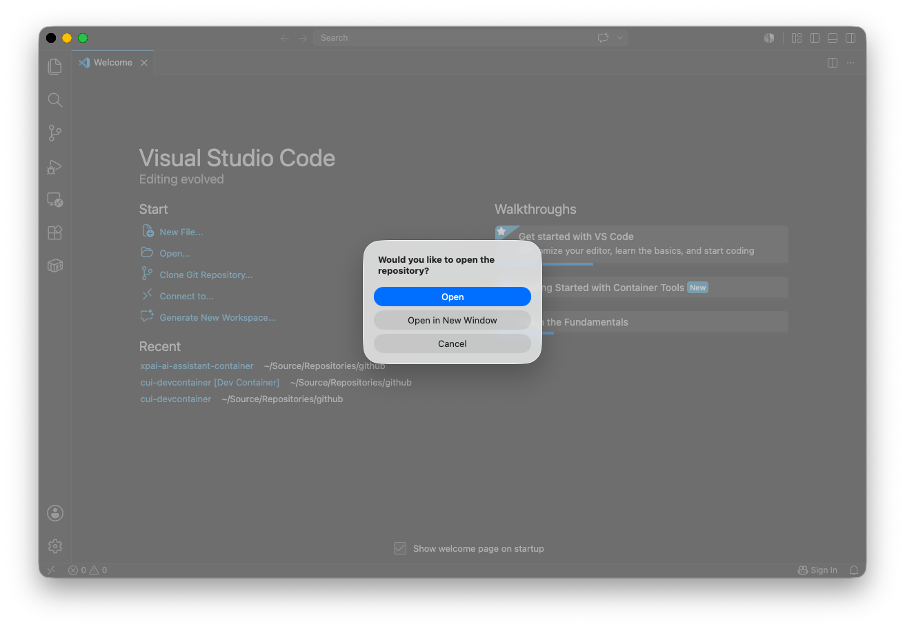

7. That's it! Your folder is now open in VS Code — you'll see its files listed on the left.

   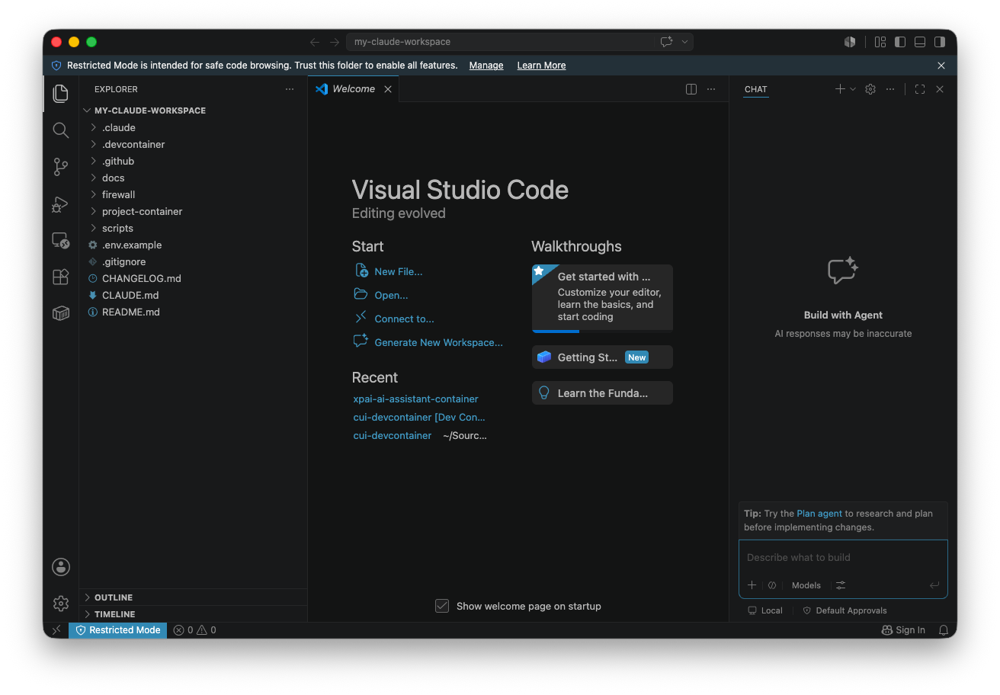

   > **Note**: If you see a blue **Restricted Mode** message at the top, click **Manage** and choose to trust the folder. This folder came from your own GitHub account, so it's safe — and later steps need it trusted to work.

💡 Tip: What did I just do?

 

- **Cloning** just means downloading a copy. Your folder still lives on GitHub — now there's also a copy on your computer that you (and Claude) can actually work in.
- The sign-in pop-ups were you giving **VS Code a key to your GitHub account**. Your folder is private, so VS Code had to prove it was you before GitHub would hand over a copy. You only have to do this once — VS Code remembers.

So in this step, you connected VS Code to your GitHub account and put a working copy of your Claude folder on your computer.

---

## Step 4: Install the Dev Containers Extension

VS Code needs one add-on to run Claude's workspace: the **Dev Containers** extension, made by Microsoft.

1. **[Click here to open the Dev Containers extension page](https://marketplace.visualstudio.com/items?itemName=ms-vscode-remote.remote-containers)** and click the green **Install** button there — your browser will ask to open Visual Studio Code; allow it.
2. VS Code opens a page for the **Dev Containers** extension. Click the blue **Install** button.

   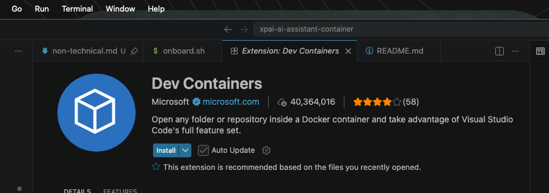

3. After a moment, the **Install** button changes — that means it's done. You may also see a pop-up in the corner about a Dev Container configuration; you can ignore it for now.

   > **Link not working?** You can install it from inside VS Code instead: click the **Extensions** icon in the left sidebar (the four squares), search for `Dev Containers`, and click **Install** on the one by Microsoft.

💡 Tip: What did I just do?

 

- An **extension** is an add-on for VS Code — like an app you install on your phone to give it a new ability.
- **Dev Containers** is the extension that lets VS Code run your folder inside a **container** — a clean, pre-built workspace with Claude and all its tools already installed and set up. That's why you don't have to install Claude or anything else by hand.

So in this step, you gave VS Code the ability to open your folder in the ready-made workspace where Claude runs.

---

## Step 5: Turn On Admin Privileges

The setup in the next step installs software on your Mac, which requires temporary administrator access. You can give yourself that access right from the menu bar — no IT ticket needed.

1. Click the **Jamf icon** in your menu bar (the same one from Step 1) and choose **Request Admin Privileges**.

   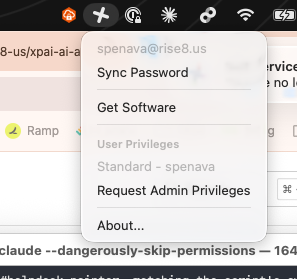

   > If you see **End Admin Privileges** instead, you already have admin access — skip to the next step.

2. A window asks why you need it. Select **Software Install** and click **Continue**.

   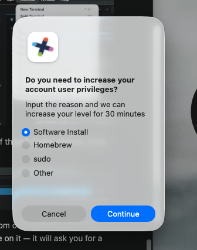

3. That's it — you now have admin access for **30 minutes**. Head straight to the next step so the setup can use it while it lasts.

💡 Tip: What did I just do?

 

- Your everyday account is a **standard** account — it can use apps but not install system software. That's a safety feature, not a restriction on you.
- **Admin privileges** are like a temporary master key: for the next 30 minutes, your account is allowed to install software. It switches back to normal automatically — nothing for you to undo.

So in this step, you borrowed the master key just long enough for the setup to do its installing.

---

## Step 6: Run the Onboarding Setup

Your folder includes a setup helper that installs and configures everything else Claude needs on your Mac. You'll kick it off from a menu in VS Code and then follow its prompts — it explains each thing it does as it goes.

1. In the menu bar at the top of your screen, click **Terminal → Run Task...**

   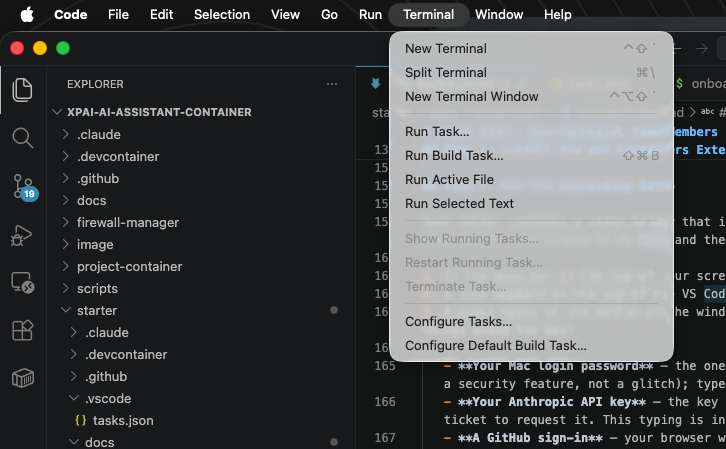

2. A list appears at the top of the VS Code window. Click **Run Onboarding**.

   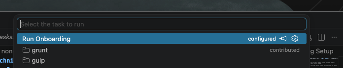

3. A panel opens at the bottom of the window and the setup begins. Keep an eye on it — it will ask you for a few things along the way:

   - **Your Mac login password** — the one you use to unlock your computer. Your typing will be invisible (that's a security feature, not a glitch); type it and press Enter.

     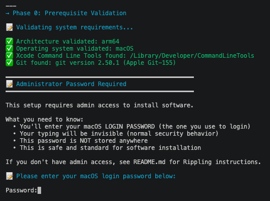
   - **Your Anthropic API key** — ⚠️ **LEAVE THIS BLANK — just press Enter to skip it** (unless you've been explicitly instructed to use an API key). Most Risers sign in to Claude with the team license in a later step instead, so no key is needed here. If you *were* told to use a key and don't have one, file a **#helpdesk** ticket to request it.
   - **A GitHub sign-in** — your browser will open and ask you to authorize; approve it just like you did in Step 3.

4. After the password, the setup starts installing tools, and the panel will fill with a lot of fast-moving technical text like this:

   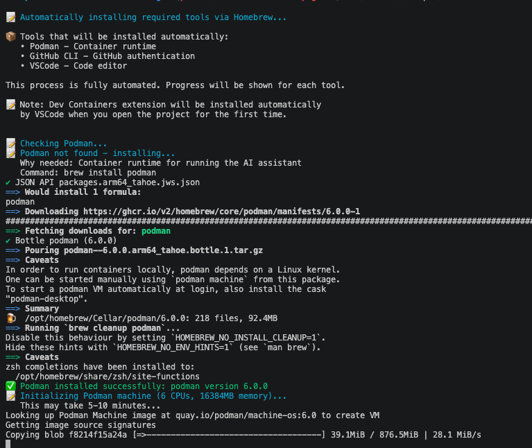

   **This is normal — you don't need to read or understand any of it.** Just let it run. Don't close the panel or the window while it's working.

5. The setup takes a while the first time (often 15–30 minutes) — it's downloading and installing several tools. It's done when you see the **"Setup Complete!"** banner with a list of green checkmarks.

> **Note**: If something goes wrong, just run it again (**Terminal → Run Task... → Run Onboarding**). The setup is designed to be safe to re-run — it skips what's already done and fixes what isn't. If it still fails, file a **#helpdesk** ticket and attach the `ai-assistant-onboard.log` file from your folder.

💡 Tip: What did I just do?

 

- The setup helper is a **script** — a to-do list of setup chores your computer runs through automatically, so you don't have to do ~15 technical steps by hand.
- It installs the behind-the-scenes tools Claude's workspace needs (like the container software that runs it), stores your API key safely on your computer, and connects everything to your GitHub account.
- Asking for your **password** is normal — installing software on a Mac always requires it, the same as when you install an app yourself. The script doesn't store it anywhere.

So in this step, your computer did all the technical setup for you — and it double-checked its own work at the end.

---

## Step 7: Open Your Folder in the Container

Time to step inside Claude's workspace. You'll tell VS Code to reopen your folder *inside the container* — the ready-made environment the setup just built.

1. Press **Cmd+Shift+P** (⌘⇧P) to open the command box at the top of the window.
2. Type `rebuild`, then click **Dev Containers: Rebuild and Reopen in Container**.

   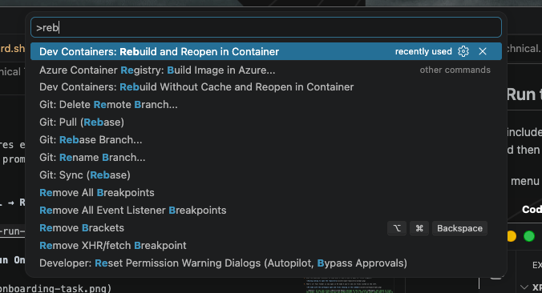

3. VS Code reloads and starts building the workspace. The **first time takes a while (5–15 minutes)** — it's downloading the container image. A progress notification appears in the bottom-right corner; you can click **show log** to watch, but just like the setup script, it's fine to let it run.
4. You're in when the window finishes reloading and the **bottom-left corner shows a blue "Dev Container" badge**. The panel at the bottom will say **"Container ready"** followed by "Done. Press any key to close the terminal" — press any key to tidy that away.

   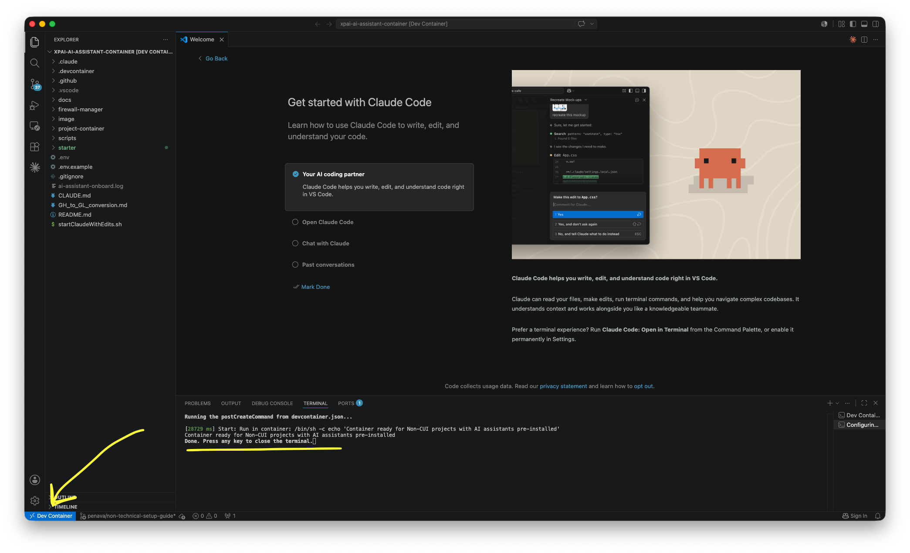

💡 Tip: What did I just do?

 

- A **container** is a self-contained workspace — think of it as a fully furnished office that gets assembled fresh on your computer, with Claude and every tool it needs already set up inside.
- "Reopening in the container" means VS Code moved your folder into that office. Your files are the same ones on your computer — you're just working on them from inside the prepared environment now.
- This is why the earlier steps existed: the setup installed the machinery that runs containers, and this step used it for the first time.

So in this step, you stepped into the ready-made workspace where you'll actually talk to Claude.

---

## Step 8: Start Claude and Sign In

The moment you've been setting up for — starting Claude for the first time.

1. In the menu bar at the top of your screen, click **Terminal → New Terminal**.

   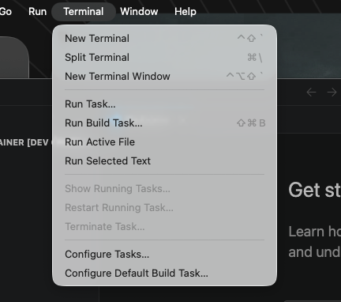

2. A panel opens at the bottom of the window. Type `claude` and press **Enter**.

   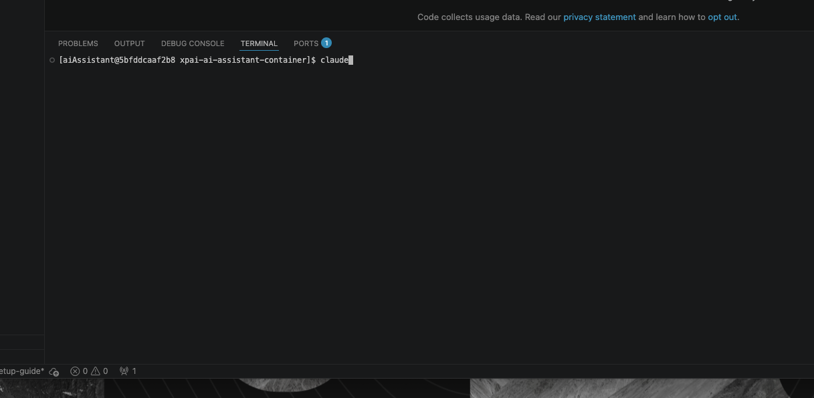

3. Claude Code starts up with a welcome screen. If it says it **detected an API key** and asks whether to use it, choose **No** — most Risers sign in with the Rise8 Claude team license instead. (Use the arrow keys to highlight your choice and press **Enter**.)

   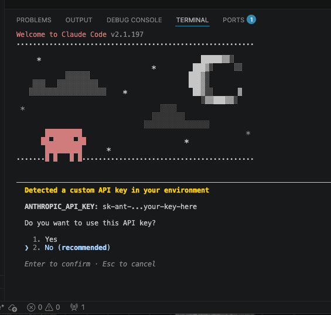

   > Only choose **Yes** here if you were specifically given a personal API key to use.

4. When Claude asks how you'd like to log in, select **Claude account with subscription**.

   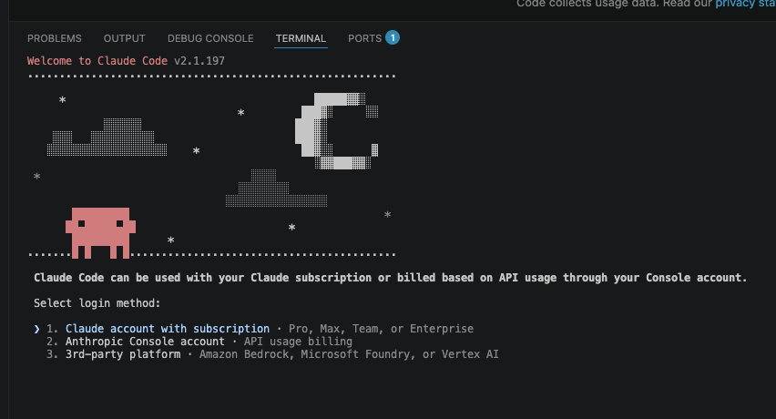

5. VS Code asks permission to open the sign-in page in your browser. Click **Open**.

   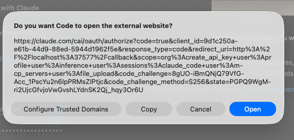

6. Your browser opens to a page saying **Claude Code would like to connect to your Claude chat account**. Sign in with your Rise8 Claude team account if asked, then click **Authorize**.

   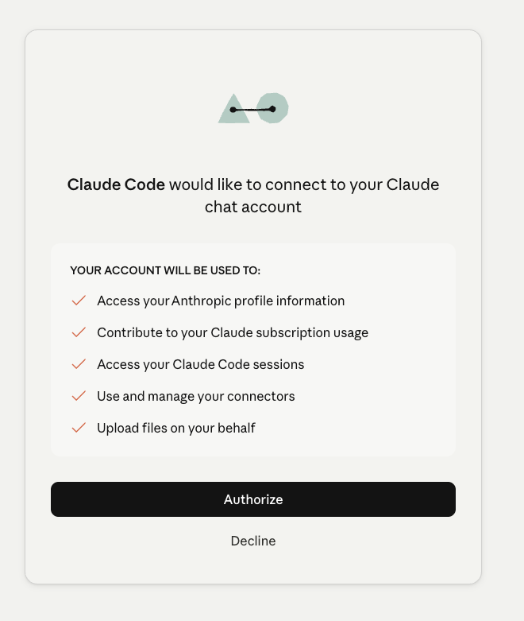

7. The browser shows **"Build something great — You're all set up for Claude Code."** That's your success signal; you can close that browser window.

   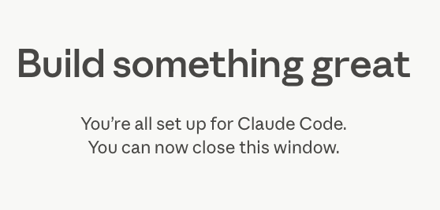

8. Back in VS Code, the terminal panel now says **"Logged in as [your email] — Login successful."** Press **Enter** to continue, and Claude is ready — you can just type to it.

   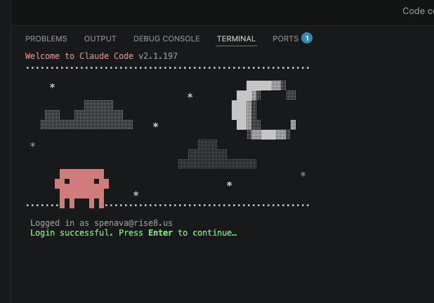

💡 Tip: What did I just do?

 

- The **terminal** is a text window for talking to your computer — and now, to Claude. Typing `claude` starts Claude Code, the version of Claude that can actually read and edit the files in your folder.
- The **API key vs. team license** question is just "how should Claude bill this?" An API key is pay-per-use; the **team license** is the company subscription — that's why Risers choose No to the key and sign in with their Claude account instead.

So in this step, you started Claude, connected it to the company's subscription, and said hello. From now on, getting to Claude is just: open your folder in VS Code, reopen in the container, open a terminal, type `claude`.

---

## Step 9: Work with Claude

You're all set up — here's how to think about your new workspace.

**Your folder is Claude's world.** The folder you cloned in Step 3 (for example, `Documents/my-claude-workspace`) is a real folder on your Mac, and it's the workspace Claude lives in:

- **Anything you put in the folder, Claude can see.** Drop in a document, a spreadsheet export, meeting notes, a PDF — using Finder or by dragging it into VS Code's file list on the left — and then just ask Claude about it: *"Read draft-proposal.md and suggest improvements."*
- **Anything Claude makes appears there too.** Ask Claude to write a summary, draft a document, or organize notes, and the files it creates show up in the sidebar on the left, ready for you to open, edit, or share.
- **Claude can change files in the folder** — rename, reorganize, edit, combine. Working with files is the whole point; that's what makes this different from chatting with Claude in a browser.
- **Claude can't see anything outside the folder.** Your email, your Desktop, your other documents — invisible to it. If you want Claude's help with a file, put a copy in the workspace. That boundary is a feature: you always know exactly what Claude has access to.

A few good first things to try typing to Claude:

- *"What's in this folder? Give me a tour."*
- *"Create a file called ideas.md and help me brainstorm [topic]."*
- Drop in a document, then: *"Summarize this in three bullet points."*

**Getting back here tomorrow:** open VS Code → click your folder's **`[Dev Container]`** entry in the Recent list → **Terminal → New Terminal** → type `claude` for a new conversation, or `claude --continue` to pick up right where you left off. The full routine (with a picture of which entry to click, and how to name a conversation so you can find it again) is in **[Getting Back Into Your Container](getting-back-in.md)**.

💡 Tip: Why a folder and not just a chat?

 

- A browser chat with Claude forgets context and can't touch your files — everything lives in the conversation.
- Here, the **folder is the shared desk** between you and Claude. You both read and write the same files, so work builds up over time instead of disappearing when the chat ends.
- And because your folder is connected to GitHub (from Step 2), your work can be backed up there too — ask Claude to help you save your changes to GitHub when you've made something worth keeping.

---

**[← Back to Quick Start by Role](../QUICK-START-BY-ROLE.md)** | **[Main README](../../README.md)**
